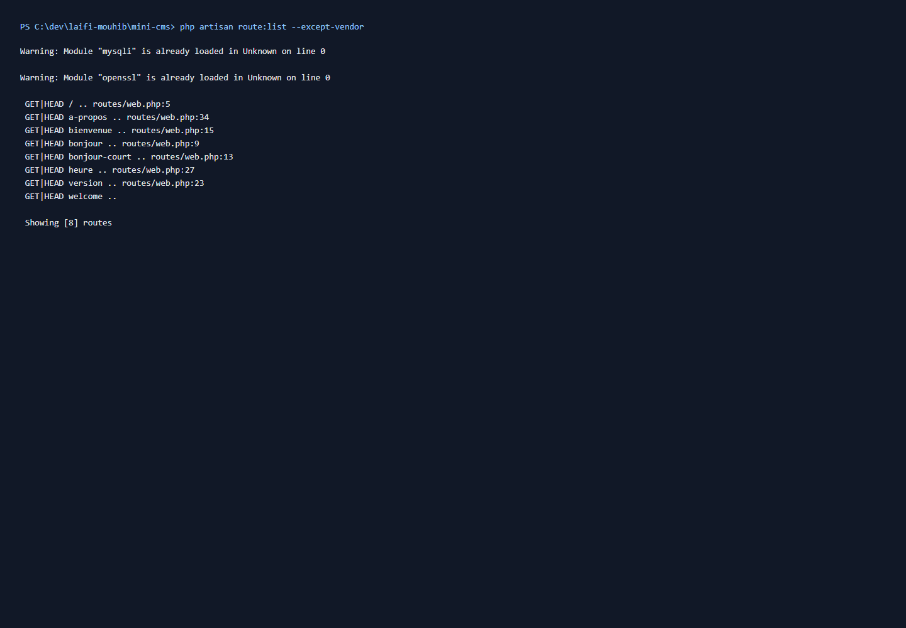
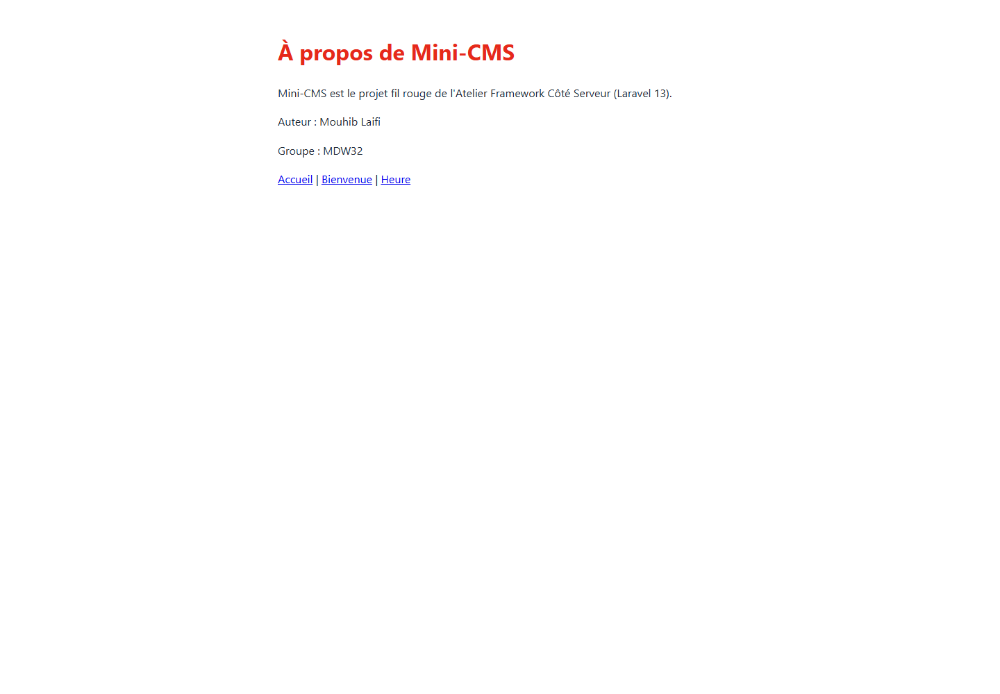
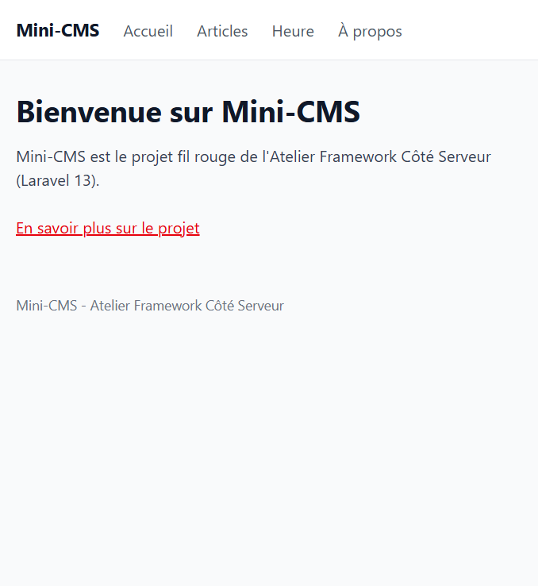
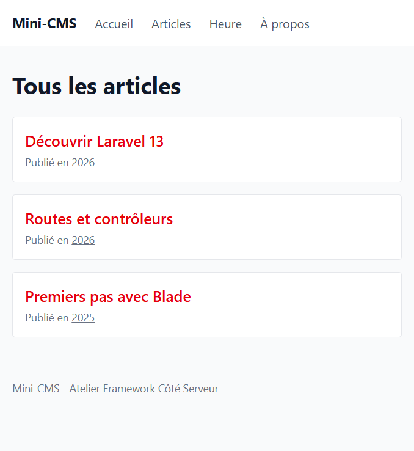
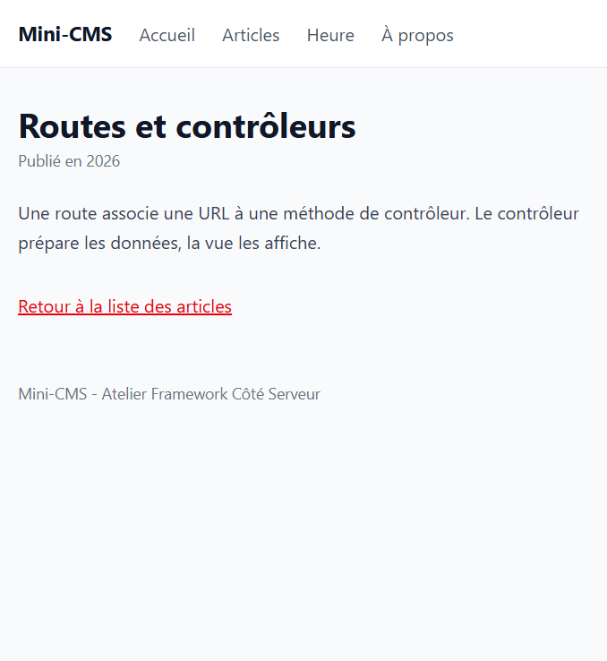
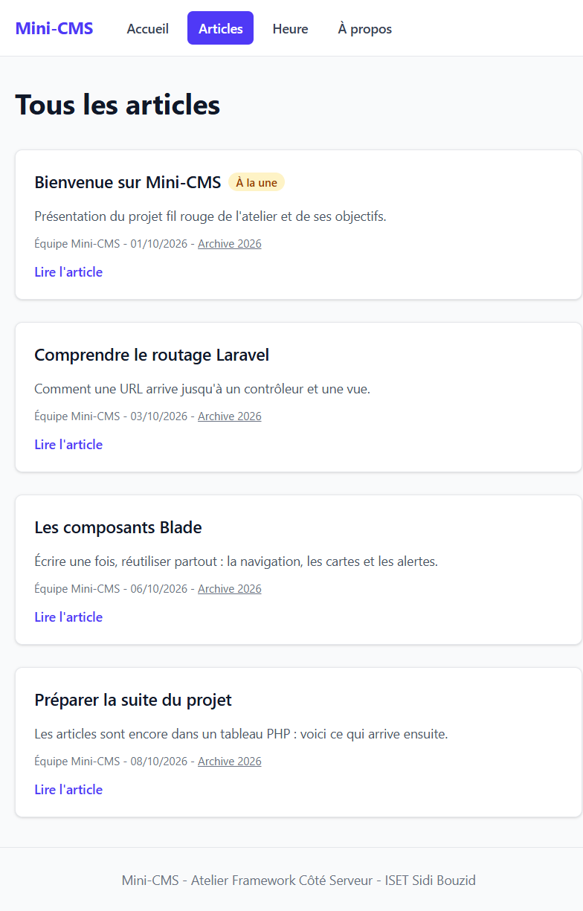
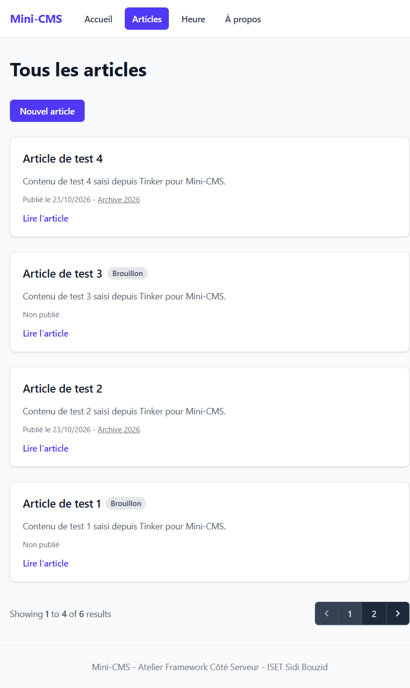
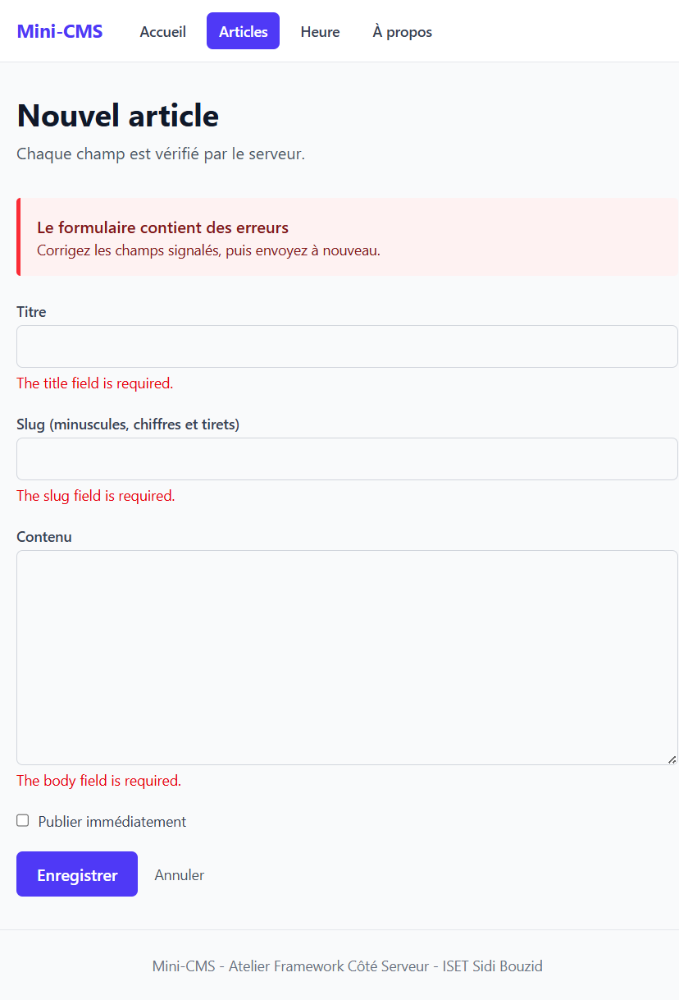

# Mini-CMS

Projet fil rouge de l'Atelier Framework Côté Serveur (Laravel 13, PHP 8.3+), 3e année MDW, ISET Sidi Bouzid.

Auteur : Mouhib Laifi, groupe MDW32.

Mini-CMS évoluera au fil du semestre vers une petite plateforme de publication : pages publiques, back-office authentifié, API JSON et tests Pest. Chaque session se termine par un tag Git (`lab-01`, puis un tag par session).

## État actuel (tag lab-03)

- Articles enregistrés dans une base SQLite et lus avec le modèle Eloquent `Post`.
- Table `posts` créée par une migration : après un clone, `php artisan migrate` la recrée (vide).
- Liste paginée, détail par liaison modèle-route, formulaire de création avec validation côté serveur.
- Premiers tests Pest : `php artisan test`.

## Routes disponibles

| Méthode | URI | Nom | Action |
|---|---|---|---|
| GET | `/` | `home` | `PageController@home` |
| GET | `/a-propos` | `about` | `PageController@about` |
| GET | `/heure` | `time` | `PageController@time` |
| GET | `/posts` | `posts.index` | `PostController@index` |
| GET | `/posts/archive/{year}` | `posts.archive` | `PostController@archive` |
| GET | `/posts/create` | `posts.create` | `PostController@create` |
| POST | `/posts` | `posts.store` | `PostController@store` |
| GET | `/posts/{post}` | `posts.show` | `PostController@show` |

## Prérequis

- PHP 8.3 ou plus, avec les extensions `curl`, `fileinfo`, `mbstring`, `openssl`, `pdo_sqlite`, `sqlite3` et `zip`.
- Composer 2.
- Node.js LTS et npm.
- Git.

## Installation

### Bash (Git Bash, macOS, Linux)

```bash
git clone https://github.com/TOGOMORI001/laravell-app.git
cd laravell-app
composer install
npm install
cp .env.example .env
php artisan key:generate
touch database/database.sqlite
php artisan migrate
composer run dev
```

### PowerShell (Windows)

```powershell
git clone https://github.com/TOGOMORI001/laravell-app.git
cd laravell-app
composer install
npm install
copy .env.example .env
php artisan key:generate
New-Item database\database.sqlite -ItemType File
php artisan migrate
composer run dev
```

Ouvrir ensuite <http://localhost:8000>. L'adresse de l'application est différente de celle de Vite, qui utilise le port 5173.

## Captures d'écran

### Page d'accueil


### Liste des routes



### Page À propos



### Accueil avec le layout



### Liste des articles



### Détail d'un article



### Session 04



### Session 05




