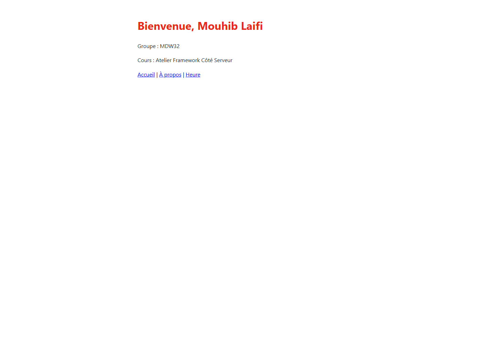

# Mini-CMS

Projet fil rouge de l'Atelier Framework Côté Serveur (Laravel 13, PHP 8.3+), 3e année MDW, ISET Sidi Bouzid.

Auteur : Mouhib Laifi, groupe MDW32.

Mini-CMS évoluera au fil du semestre vers une petite plateforme de publication : pages publiques, back-office authentifié, API JSON et tests Pest. Chaque session se termine par un tag Git (`lab-01`, puis un tag par session).

## État actuel

- Routes en closures : `/`, `/bonjour`, `/bonjour-court`, `/bienvenue`, `/version`, `/heure` et `/a-propos`.
- Vues Blade : `welcome`, `bienvenue`, `heure` et `a-propos`.
- Base de données SQLite locale (`database/database.sqlite`, non versionnée).
- Le dépôt est hébergé sur GitHub : [TOGOMORI001/laravell-app](https://github.com/TOGOMORI001/laravell-app).

## Routes disponibles

| Méthode | URI | Réponse |
| --- | --- | --- |
| GET | `/` | Vue `welcome` (page d'accueil Laravel) |
| GET | `/bonjour` | Message de bienvenue en texte |
| GET | `/bonjour-court` | Même type de réponse avec une fonction fléchée |
| GET | `/bienvenue` | Vue `bienvenue` avec le nom, le groupe et le cours |
| GET | `/version` | Versions de Laravel et de PHP |
| GET | `/heure` | Vue `heure` avec l'heure et la date |
| GET | `/a-propos` | Vue `a-propos` avec le nom de l'auteur et le groupe |
| GET | `/welcome` | Alias conservé de la page d'accueil Laravel |

## Prérequis

- PHP 8.3 ou plus, avec les extensions `curl`, `fileinfo`, `mbstring`, `openssl`, `pdo_sqlite`, `sqlite3` et `zip`.
- Composer 2.
- Node.js LTS et npm.
- Git.

## Installation

### Bash (Git Bash, macOS, Linux)

```bash
git clone https://github.com/TOGOMORI001/laravell-app.git
cd laravell-app
composer install
npm install
cp .env.example .env
php artisan key:generate
touch database/database.sqlite
php artisan migrate
composer run dev
```

### PowerShell (Windows)

```powershell
git clone https://github.com/TOGOMORI001/laravell-app.git
cd laravell-app
composer install
npm install
copy .env.example .env
php artisan key:generate
New-Item database\database.sqlite -ItemType File
php artisan migrate
composer run dev
```

Ouvrir ensuite <http://localhost:8000>. L'adresse de l'application est différente de celle de Vite, qui utilise le port 5173.

## Captures d'écran

### Page d'accueil


### Page Bienvenue



### Liste des routes


### Page À propos


La commande `php artisan migrate` crée les tables internes de Laravel, notamment celles utilisées pour les sessions et le cache. Les migrations sont étudiées en session 05.
